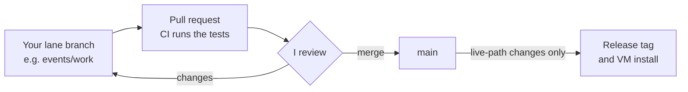

# CreditTrading

QUANTT's credit trading book, run by the Credit Trading Team at Queen's University.

[](https://github.com/quanttqueensu/CreditTrading/actions/workflows/checks.yml)

I'm Simon, and I run the book. This page is for the three analysts working with me
this year: what we trade, what each of you will work on, and how your work gets into
the repo. Setting up your Mac is in [`docs/ONBOARDING.md`](docs/ONBOARDING.md), and the
detailed rules of the team are in [`docs/TEAM.md`](docs/TEAM.md).

## What we trade

We run a systematic long/short book in credit closed-end funds (CEFs). A CEF
publishes its net asset value every day, but its shares trade at whatever the market
will pay, usually at a discount. Nothing creates or redeems the shares, so nothing
forces that discount to close.

Every evening the book compares each fund's discount with its own history. It buys
the funds that are unusually cheap, shorts the ones that are unusually rich, in equal
dollars, and sizes the whole book to a volatility target. A position is only traded
once it drifts outside a no-trade band. Orders go in at the next day's close, and the
position earns the day after that. We call that lag `shift(2)`, and every backtest in
this repo has to use it.

The book trades by itself every day on an Alpaca paper account, from a cloud VM that
only I can reach. Real capital is planned, which is why so much of our work is about
costs.

The full description is in [`docs/SYSTEM.md`](docs/SYSTEM.md). Anything that changes day
to day (whether prod is running, the account, the spec, how many trials each counter
has used) comes from `python3 -m ops.orient`. I keep those numbers off this page
because they go stale.

## What you'll work on this year

Each of you owns a lane. You keep its folders working, keep its trial counter honest,
and bring me results. You can still propose a change anywhere in the repo through a
pull request.

This is my first draft of the year, as of October 2026, and it will move as results
come in. The live status of every project is in
[`docs/RESEARCH_STATE.md`](docs/RESEARCH_STATE.md).

### Events and special situations

Counter EVENTS. Folders `scripts/events/` and `results/events/`. Branch `events/work`.

Trades around corporate events in CEFs and BDCs, where the mechanics give prices a
reason to move.

- E1, the CEF merger pair (long the target, short the acquirer), was EVENTS trial 1
  ([`results/events/PREREG_E1_MERGER_PAIR_2026-10-19.md`](results/events/PREREG_E1_MERGER_PAIR_2026-10-19.md)).
  Its fit was killed on 22 October under D4: the deals made money, but the alpha
  didn't clear our bar. Its holdout is still to be read, and I'll share the
  write-up when it is.
- Finish NAV tenders, EVENTS trial 2:
  [`results/events/PREREG_NAV_TENDER_2026-10-19.md`](results/events/PREREG_NAV_TENDER_2026-10-19.md).
- Go through the special-situations slate with me. The census of ideas is on my
  branch, `pm/work`, and I haven't ruled on it yet.
- Then, as their gates allow: convertible-issuance reversal (E2), listed mandatory
  converts (E3) and the CEF IPO pair (E4).

The goal is one or two event sleeves trading on paper by the end of the year.

### Cross-asset and options

Counters XASSET and GAMMA. Folders `scripts/xasset/`, `scripts/gamma/` and their
`results/`. Branch `xasset/work`, for both counters.

- Options: we've agreed to run exactly one standalone test, selling TLT volatility
  (G1). Its gate G2 was run on free data in October: two of its three parts pass, and
  the cost part fails under our conservative spread assumption
  ([`results/gamma/G2_GATE_FREE_DATA_2026-10-12.md`](results/gamma/G2_GATE_FREE_DATA_2026-10-12.md)).
  It needs a real measure of option spreads during market hours first. Whether we pay
  for that data is a call we'll make together.
- Cross-asset: the first slate of four ETF signals all failed in October, so no sleeve
  came out of it ([`results/xasset/XASSET_RESULTS_2026-10-14.md`](results/xasset/XASSET_RESULTS_2026-10-14.md)).
  A new idea is declared as a new slate and pre-registered before anything runs.

The goal is a clear yes or no on options, and at most one new cross-asset slate, run
properly.

### Research platform

Folders `scripts/data/`, `src/data/`, `results/data/`, plus CI and the tests. Branch
`platform/work`.

- Keep CI green.
- Move the research-only Python packages out of `requirements.txt` so the prod VM
  never installs them. Leave numexpr out entirely: pandas uses it for arithmetic once
  it is installed.
- Own the fetchers the other lanes need: ETF history, EDGAR events, and NAV history
  for funds outside our universe.
- Build the read-only dashboard. Nothing on it may be able to send an order.

The goal is that nobody loses a day to broken data or a red build.

### Me

The core CEF book and its costs, everything that can change what the book trades,
prod, releases, and the decision on every trial. The big item this year is the
real-money cost check (`scripts/cef/real_money_costs.py`): the book has to stay positive
after measured borrow, distributions owed on shorts and real auction fills before any
real capital goes in. My work in progress sits on `pm/work`.

## Getting started

1. Accept the GitHub invitation to this repo. It arrives by email.
2. Set up your Mac with [`docs/ONBOARDING.md`](docs/ONBOARDING.md#2-set-up-your-mac):
   clone, install, and put your own keys in `config/.env`.
3. Run the three checks:
   ```bash
   python3 -m ops.orient            # PROD shows UNMEASURED on your machine, which is expected
   python3 -m pytest                # nothing should fail
   python3 -m ops.doc_audit --check # no DRIFT
   ```
4. Add one line to your own `~/.claude/CLAUDE.md` saying which lane you're in, so
   Claude knows you're an analyst (step 2.6 of the onboarding).
5. Read the ten files in
   [the reading order](docs/ONBOARDING.md#4-what-to-read-in-order), then your lane's.

## Making a change

You work on your lane's branch and send me pull requests. I review them and merge
into `main`. If a change touches the live book, I also tag a release and install it on
the VM.



```bash
git fetch origin
git switch events/work           # your branch: events/work, xasset/work or platform/work
git merge origin/main            # do this at the start of every day
# ...work and commit...
python3 -m pytest && python3 -m ops.doc_audit --check
git push
gh pr create --base main         # when a piece is ready for me
```

GitHub holds five branches and no more: `main`, one for each of you (`events/work`,
`xasset/work`, `platform/work`) and mine, `pm/work`. Please don't create others. A
branch can only have one open pull request, so anything you push while yours is open
joins it. Keep pieces small and I'll merge them quickly.

Trials work differently from everything else. Anything that computes a strategy's
returns spends a trial, so write the pre-registration first (`/prereg`), send it to me
as a PR, and only run it once I've approved it. Counts, gates, reproductions and data
work don't need that step. The details are in
[`docs/TEAM.md`](docs/TEAM.md#4-trials-and-the-shared-ledgers).

## Ground rules

- Don't place, change or cancel orders, and don't run `quantt.session` or
  `quantt.collect`. You don't hold keys for the book's account, and an order can't be
  undone.
- Don't commit credentials, or row-level licensed data (CRSP, TRACE, anything from
  WRDS). The repo is public.
- Don't make up numbers. Every figure says which script produced it and when.
- Backtest with `evaluate()` in [`scripts/cef/band_frontier.py`](scripts/cef/band_frontier.py).
  Lead with gross P&L and put the 5/15/30bp cost grid beside it.
- Run `/graveyard` before proposing an idea. Most of them have been tried.
- I'm the only one who merges to `main` or deploys, and GitHub enforces that
  ([`docs/TEAM.md`](docs/TEAM.md#6-access)).

The full rules are in [`CLAUDE.md`](CLAUDE.md). They apply to people as well as to
Claude.

## Finding things

| Looking for | Go to |
|---|---|
| What is true right now | `python3 -m ops.orient` |
| How the strategy and the system work | [`docs/SYSTEM.md`](docs/SYSTEM.md) |
| The code that trades | [`src/deploy/sleeves/cef_discount.py`](src/deploy/sleeves/cef_discount.py) |
| How a trading day runs | [`docs/RUNNER.md`](docs/RUNNER.md) |
| What's been tried, and what died | [`docs/RESEARCH_STATE.md`](docs/RESEARCH_STATE.md) |
| The research plan | [`results/cef/RESEARCH_PLAN_2026-10-09.md`](results/cef/RESEARCH_PLAN_2026-10-09.md) |
| Data sources | [`docs/DATA.md`](docs/DATA.md) |
| Your lane and what you may touch | [`docs/TEAM.md`](docs/TEAM.md) |
| Which document answers what | [`docs/INDEX.md`](docs/INDEX.md) |

<details>
<summary>Repository map</summary>

```
src/deploy/          the strategy: sleeves/cef_discount.py is the book          live
quantt/              the runner (decide, check, send, verify), collector, installers   live
ops/specs/, books/   the frozen spec and the book's settings                    live
ops/                 orient, doc_audit, prod_state, NYSE calendar, network guard
scripts/cef/         the research harness: band_frontier, validate, CEF trials
scripts/events/      events research
scripts/xasset/      cross-asset research
scripts/gamma/       options research
scripts/data/        fetchers and data builds: EDGAR, CRSP, CEFConnect, factors
src/backtest/        the original engine, lookahead guard, cost model
results/<family>/    dated findings and pre-registrations
docs/                the documents, one owner per question (docs/INDEX.md)
.claude/             Claude Code: skills, agents, hooks, workflows
config/              the cost model, and your own .env (never committed)
data/                the data panels: not in git, you build your own
```

Anything marked live can change the book, so it needs a test, my review and a release.

</details>

<details>
<summary>Commands you'll use</summary>

```bash
python3 -m ops.orient                                # what is true right now
python3 -m pytest                                    # the tests
python3 -m ops.doc_audit --check                     # do the documents still say true things?
python3 -m quantt.broker.alpaca_probe --check-keys   # which of your keys are set (prints no values)
python3 scripts/cef/stage_cef.py                     # build the CEF price and NAV panels
python3 scripts/cef/fetch_daily.py                   # bring them up to date
python3 scripts/cef/band_frontier.py                 # the trading-policy frontier
```

In Claude Code, the skills you'll use most are `/graveyard`, `/harness`, `/repro` and
`/prereg`, plus the `/research-idea` and `/backtest-request` workflows. Ask for the
`beta-detector` or `quant-reviewer` agent before you trust a result.

</details>

<details>
<summary>History</summary>

The repo was cut back to a clean slate on 2026-09-28, when the book moved from IBKR to
Alpaca. Everything from before then is in git at the tag `pre-clean-slate`, summarised
in [`docs/HISTORY.md`](docs/HISTORY.md).

</details>
