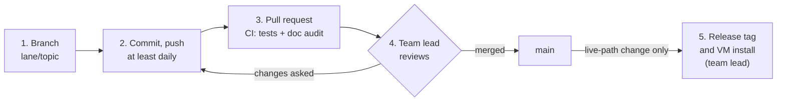

# CreditTrading

**QUANTT, Queen's University: Credit Trading Team.** Team lead: Simon Jarvis.

A systematic **credit closed-end-fund discount-reversion** book. It trades every
day, by itself, on Alpaca paper from a cloud VM. Real capital is planned.

[](https://github.com/quanttqueensu/CreditTrading/actions/workflows/checks.yml)

> **New analyst?** Read this page, then follow
> [`docs/ONBOARDING.md`](docs/ONBOARDING.md) to set up your Mac. Your lane and the
> rules of the pod are in [`docs/TEAM.md`](docs/TEAM.md).
> **Only the team lead merges to `main` and deploys to prod.**

---

## The strategy in six lines

1. A **closed-end fund** (CEF) publishes its net asset value (NAV) daily; its
   shares trade at whatever the market pays, usually at a **discount** to NAV.
2. Nothing creates or redeems CEF shares, so nothing forces that discount closed.
3. We **buy** credit CEFs unusually cheap against **their own** discount history
   and **short** the unusually rich ones, in equal dollars.
4. The book is sized to a **volatility target**, and a position is traded only when
   it drifts outside a **no-trade band**.
5. We **decide** each evening on that day's prices and NAVs, **fill** at the next
   day's close, and **earn** the day after: the `shift(2)` convention.
6. Every parameter lives in a **frozen spec**; only the team lead changes it.

The full account: [`docs/SYSTEM.md`](docs/SYSTEM.md). Why the edge exists:
[`docs/BRIEF.md`](docs/BRIEF.md) §2. **What is true right now** (prod, the
account, the spec, the trial counters) is never written on this page. Run
`python3 -m ops.orient` to measure it.

---

## Find your way

| I want to… | Go to |
|---|---|
| know what is true right now | `python3 -m ops.orient` |
| understand the strategy and the standing decisions | [`docs/SYSTEM.md`](docs/SYSTEM.md) |
| read the code that trades | [`src/deploy/sleeves/cef_discount.py`](src/deploy/sleeves/cef_discount.py) |
| see how a trading day runs | [`docs/RUNNER.md`](docs/RUNNER.md), "The session, in order" |
| run a backtest the right way | `evaluate()` in [`scripts/cef/band_frontier.py`](scripts/cef/band_frontier.py), and `/harness` |
| see what has been tried and what died | [`docs/RESEARCH_STATE.md`](docs/RESEARCH_STATE.md), and `/graveyard` |
| see the year's research programme | [`results/cef/RESEARCH_PLAN_2026-10-09.md`](results/cef/RESEARCH_PLAN_2026-10-09.md) |
| find a data source | [`docs/DATA.md`](docs/DATA.md) |
| check an external claim | [`docs/REFERENCES.md`](docs/REFERENCES.md) |
| know my lane and what I may touch | [`docs/TEAM.md`](docs/TEAM.md) |
| know the hard rules | [`CLAUDE.md`](CLAUDE.md): they bind people as much as agents |
| find which document answers a question | [`docs/INDEX.md`](docs/INDEX.md) |

---

## The lanes

| lane | trial counter | your folders | read first |
|---|---|---|---|
| **EVENTS** | EVENTS | `scripts/events/`, `results/events/` | [`docs/BRIEF.md`](docs/BRIEF.md) §3, "Corporate events" |
| **XASSET + GAMMA** | XASSET, GAMMA | `scripts/xasset/`, `scripts/gamma/` and their `results/` | [`results/xasset/PREREG_XASSET_SLATE_2026-10-12.md`](results/xasset/PREREG_XASSET_SLATE_2026-10-12.md) |
| **Research platform** | none | `scripts/data/`, `src/data/`, CI and tests | [`docs/DATA.md`](docs/DATA.md) |
| **Team lead** | CEF | the core book, the live path, prod | |

Anyone may propose a change to any file through a pull request. Who sits in which
lane is not written here, because the repository is public. Details: [`docs/TEAM.md`](docs/TEAM.md) §1.

---

## Your first day

1. **Accept the GitHub invitation** to this repository (GitHub e-mails it to you).
2. **Set up your Mac**: clone, install, add your own keys to `config/.env`
   ([`docs/ONBOARDING.md`](docs/ONBOARDING.md#2-set-up-your-mac)).
3. **Check it works**:
   ```bash
   python3 -m ops.orient            # PROD reads UNMEASURED on your machine: that is correct
   python3 -m pytest                # nothing should fail
   python3 -m ops.doc_audit --check # no DRIFT
   ```
4. **Tell Claude who you are**: one line in your own `~/.claude/CLAUDE.md`
   ([`docs/ONBOARDING.md`](docs/ONBOARDING.md#2-set-up-your-mac), step 2.6).
5. **Read the ten files** in [the reading order](docs/ONBOARDING.md#4-what-to-read-in-order),
   then your lane's list.

---

## Make a change



```bash
git switch main && git pull
git switch -c events/my-topic            # your lane: events/, xasset/, gamma/ or platform/
# ...work, commit small...
git push -u origin events/my-topic       # push at least daily
git fetch origin && git merge origin/main
python3 -m pytest && python3 -m ops.doc_audit --check
gh pr create                             # the template asks the team lead's questions
```

**Spending a trial** (a test that computes a strategy's returns):
draft its pre-registration with `/prereg`, open a PR, and wait for the team lead's
approval. The counter moves in the commit that records it. Only then run it.
Zero-trial work (counts, gates, reproductions, data) needs only the PR.
Details: [`docs/TEAM.md`](docs/TEAM.md#4-trials-and-the-shared-ledgers).

---

## Seven rules you cannot break

| rule | why |
|---|---|
| **Never send, replace or cancel an order**, and never run `quantt.session` or `quantt.collect` | Orders are irreversible, and the book's account is the team lead's alone |
| **Never commit a credential or row-level licensed data** (CRSP, TRACE, any WRDS table) | This repository is public |
| **Never invent a number.** Every figure names the script that produced it and its date, labelled [V] / [S] / [U] | Confident wrong numbers have cost this desk more than missing ones |
| **Backtest only with `evaluate()`**: `shift(2)`, gross P&L first with the 5 / 15 / 30bp grid beside it, turnover-matched | Otherwise no result is comparable to any other |
| **Check `/graveyard` before proposing anything** | Most ideas here have already died once |
| **No trial returns before the pre-registration is approved**; a holdout is opened once | The trial counters and holdouts are only worth something while this holds |
| **Only the team lead merges and deploys** | GitHub rulesets enforce it ([`docs/TEAM.md`](docs/TEAM.md#6-access)); prod runs only release tags |

The full set: [`CLAUDE.md`](CLAUDE.md). What an analyst never does, and what stops
it: [`docs/TEAM.md`](docs/TEAM.md#5-what-an-analyst-never-does).

---

## Claude Code helpers

| type | what it does |
|---|---|
| `/graveyard` | what has died, and how |
| `/harness` | how to run a backtest that compares to existing numbers |
| `/repro` | reproduce a figure before you quote it |
| `/prereg` | draft a pre-registration for a trial |
| `/research-idea` | take an idea from graveyard check to a reviewed result |
| `/backtest-request` | one backtest question, independently re-derived |
| `beta-detector`, `quant-reviewer` | ask for one before you trust a result or your code |

The full agent layer: [`.claude/README.md`](.claude/README.md).

---

<details>
<summary><b>Repository map</b></summary>

```
src/deploy/          the strategy: sleeves/cef_discount.py IS the book           LIVE
quantt/              the runner (decide, gate, send, verify), collector, installers LIVE
ops/specs/, books/   the frozen spec and the book json: governance objects       LIVE
ops/                 orient, doc_audit, prod_state, NYSE calendar, network guard
scripts/cef/         the research harness: band_frontier, validate, the CEF trials
scripts/events/      EVENTS research
scripts/xasset/      XASSET research
scripts/gamma/       GAMMA research (options)
scripts/data/        fetchers and data builds: EDGAR, CRSP, CEFConnect, factors
src/backtest/        the original engine, lookahead guard, cost model
results/<family>/    dated findings and pre-registrations, each true as of its date
docs/                one owner per question (docs/INDEX.md)
.claude/             Claude Code: skills, agents, hooks, workflows
config/              the cost model, and your own .env (never committed)
data/                the panels: gitignored, you build your own
```

LIVE means a change can reach the book. It needs a test that fails against the old
behaviour, the team lead's review and a release
([`docs/TEAM.md`](docs/TEAM.md#2-the-live-path-what-can-change-the-book)).

</details>

<details>
<summary><b>Everyday commands</b></summary>

```bash
python3 -m ops.orient                                # what is true right now
python3 -m pytest                                    # the test suite: run it, never quote a count
python3 -m ops.doc_audit --check                     # do the documents still say true things?
python3 -m quantt.broker.alpaca_probe --check-keys   # which keys are set (no network, no values)
python3 scripts/cef/stage_cef.py                     # build the CEF price and NAV panels
python3 scripts/cef/fetch_daily.py                   # bring them up to date
python3 scripts/cef/band_frontier.py                 # the trading-policy frontier
```

</details>

<details>
<summary><b>History</b></summary>

The repository was cut to a clean slate on 2026-09-28 when the book moved from IBKR
to Alpaca. Everything earlier is in git at the tag `pre-clean-slate`, summarised in
[`docs/HISTORY.md`](docs/HISTORY.md): provenance, never evidence of what is true now.

</details>

*This page carries no status figures, on purpose: they go stale. Run
`python3 -m ops.orient`.*
