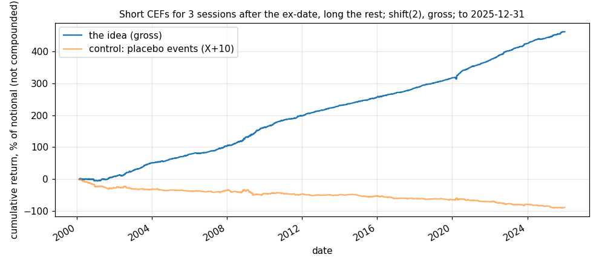

# Idea card — the ex-date cycle in closed-end funds

**Slug:** `cef_exdate_drift` · **Written:** 2026-11-10 · **Status:** SHADOW from 2026-11-10 (`shadow/books/cef_exdate_after.json`, `cef_exdate_before_after.json`) ·
**Reproducer:** `python3 scripts/research/stage_crsp_cefs.py`, then `python3 results/ideas/cef_exdate_drift/explore.py`
· **Panel:** every closed-end fund on CRSP (R2 mirror), 1,123 funds with dead ones included, last date
**2025-12-31**. 73,741 eligible ex-dates, about 2,842 a year.

A revival, widened. The desk found the post-ex-date drop on 17 and then 74 funds (−20.5bp and
−34.3bp over three sessions, 2005–22 [S: `docs/RESEARCH_STATE.md`, SCR-C4-EXDATE]), approved a
test, built it and left it off. This is the same effect on the whole universe, with no
survivorship, and with the run-up before the ex-date as well.

## The idea

Income investors buy a fund to collect its distribution and sell once they have it. The
price is bid up into the ex-date and falls by more than the distribution after it.

- **Counterparty:** retail holders who time purchases to the payout. They keep doing it
  because the distribution is what they hold the fund for; the few basis points are invisible
  to them.
- **Persistence:** each event is worth 20 to 30bp, in funds that are hard to borrow and trade
  a few million dollars a day. Too small and too awkward for a large fund.

## The rule (fixed before the test)

Short a fund from its ex-date close for three sessions; against it hold every other eligible
fund equally, so the book is dollar neutral. Eligible: price of $2 or more and $500,000 a day
of average dollar volume, both known the session before. `shift(2)` on the canonical harness.

## Gross result [V: reproducer run 2026-11-10]

No cost and no borrow is modelled. About 34 funds short and 259 long a day.

| sample | from | to | sessions | active | return / yr | vol / yr | Sharpe | t | bp per active day | hit rate |
|---|---|---|---|---|---|---|---|---|---|---|
| full | 2000-02-15 | 2025-12-29 | 6,507 | 6,347 | 17.85% | 4.27% | 4.18 | 21.25 | 7.3 | 66.9% |
| early half | 2000-02-15 | 2013-01-23 | 3,254 | 3,139 | 16.72% | 4.55% | 3.68 | 13.21 | 6.9 | 63.9% |
| late half | 2013-01-23 | 2025-12-29 | 3,254 | 3,209 | 18.99% | 3.97% | 4.78 | 17.17 | 7.6 | 69.9% |
| 2002-2008 | 2002-01-02 | 2008-12-31 | 1,763 | 1,711 | 17.48% | 4.17% | 4.19 | 11.09 | 7.1 | 64.2% |
| 2009-2015 | 2009-01-02 | 2015-12-31 | 1,762 | 1,715 | 17.84% | 3.79% | 4.71 | 12.45 | 7.3 | 67.8% |
| 2016-2019 | 2016-01-04 | 2019-12-31 | 1,006 | 988 | 15.09% | 2.73% | 5.53 | 11.05 | 6.1 | 68.6% |
| 2020-2022 | 2020-01-02 | 2022-12-30 | 756 | 745 | 28.29% | 5.77% | 4.90 | 8.49 | 11.4 | 73.2% |
| 2023-2025 | 2023-01-03 | 2025-12-29 | 750 | 748 | 20.00% | 4.16% | 4.80 | 8.28 | 8.0 | 70.2% |
| control: placebo events (X+10) | 2000-02-15 | 2025-12-29 | 6,507 | 6,337 | -3.42% | 4.24% | -0.81 | -4.10 | -1.4 | 48.0% |

Event funds less the eligible universe, in basis points by session around the ex-date X (t in brackets):

| X−3 | X−2 | X−1 | X | X+1 | X+2 | X+3 | X+4 | X+5 | X+6 |
|---|---|---|---|---|---|---|---|---|---|
| +5.8 (+15.1) | +6.8 (+17.8) | +9.0 (+24.2) | -4.7 (-11.9) | -15.5 (-36.3) | -8.7 (-21.5) | -6.2 (-14.9) | +0.7 (+1.6) | -0.9 (-2.1) | +1.4 (+3.5) |

Two variants that use the run-up, run after seeing the profile above (so they are not
pre-specified) [V: `results/ideas/cef_exdate_drift/variants.json`]:

| variant | Sharpe | t | return / yr | halves | eras (2002–08 … 2023–25) |
|---|---|---|---|---|---|
| long the three sessions before the ex-date, short the three after | 4.72 | 24.0 | 26.41% | 4.53 / 4.95 | 4.69 / 5.91 / 6.03 / 4.33 / 4.84 |
| long the three sessions before, short all other funds | 2.33 | 11.8 | 10.32% | 2.49 / 2.15 | 2.26 / 3.54 / 3.09 / 1.23 / 1.67 |

## Is it an artifact? What I checked, because a Sharpe above 4 should not be believed on sight

- **Stale prices** are this desk's most common false positive. Here they are not the cause:
  every one of the 73,741 eligible ex-dates had trading volume that day, and the ex-day
  price drop averages 1.08 times the distribution (90.8bp against 83.8bp), so prices adjust
  on the day and then keep falling.
- **It is not an illiquidity effect.** The three-session drop is larger in the most liquid
  funds: −27.9bp at $0.5–2M of daily volume, −32.1bp at $2–5M, −44.9bp above $5M.
- **The placebo is negative** (Sharpe -0.81), which is the run-up into the *next* ex-date for
  monthly payers showing in the placebo's short leg. It supports the cycle rather than
  contradicting it.
- **It matches the desk's earlier, independent measurement** on different panels.
- **Every era is positive and similar**, and the two halves agree.

## What the gross figure does not show

- **Each event is small.** The edge is 20 to 30bp per fund per leg, the same order as a
  round trip through a closed-end fund's spread, and the book turns over 144 times a year.
  This is why the desk left it off before. Paper has to measure it; I am not assuming it away.
- **The short side.** Closed-end funds are hard to borrow, and Alpaca's paper account charges
  no borrow and will not show a recall. The variant with the longs before the ex-date and a
  broad short is the form that depends least on borrowing the event funds themselves.
- **Capacity is limited.** At $5M the median short is 1.9% of the fund's average daily
  volume and the 95th percentile 16%; at $10M, 3.9% and 32% (2024–25). A sleeve
  of $1–3M is realistic.
- **Knowing the ex-date in time [U].** The rule needs it one session ahead (five for the
  run-up leg). Funds declare weeks ahead, but CRSP has no declaration date; the shadow book
  must use declared dates from a live source, and a late declaration is a missed event.
- **Correlation with C4**, which already earns part of its P&L in this window, is not
  measured here.

## On shadow

Two books at $1M each, from 2026-11-10, on the 91 funds this desk already lists
(`shadow/universes/cef_v1.csv`), not the 576 a day of the test: the pre-specified form and the
long-before, short-after form, side by side. Declared ex-dates come from Alpaca's
corporate-actions feed and are stored by the day we first saw them, so a decision can only
use an ex-date the desk already knew. Measured 2026-11-10: 76 of the 91 funds had a future
ex-date listed [V: `python3 -m shadow.fetch.exdates cef_v1`]. On the last session before the
start, 82 funds were eligible and 6 were in their post-ex window. With 91 funds the books
will be noisier than the test.

