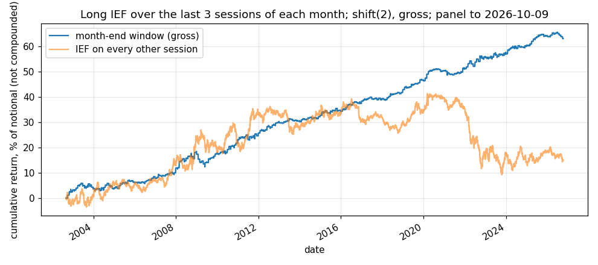

# Idea card — month-end Treasury demand

**Slug:** `month_end_ief` · **Written:** 2026-11-10 · **Status:** SHADOW from 2026-11-10
(`shadow/books/month_end_ief.json`) · **Reproducer:** `python3 results/ideas/month_end_treasury/explore.py`
· **Panel:** the desk's ETF panel, IEF total returns, last date **2026-10-09**.

A revival. The desk tested this on 2026-10-14 as XASSET-X3 and found the effect, then stopped it
for term-premium exposure and for cost at an assumed 15bp (`docs/RESEARCH_STATE.md`, KILLED
table). The team lead dropped both gates on 2026-11-09. Nothing about the rule is changed.

## The trade

Long IEF (7–10 year Treasuries) from the close three sessions before the month's last session
to that last close. Flat the rest of the month. Three sessions a month, 14% of days.

## Mechanism

Bond indices add the month's new issuance and drop bonds that fall below their maturity
floor at each month end, which lengthens the index. Funds that track an index have to hold
the new index at the last close, so they buy duration into it. The buying is known in
advance and is not sensitive to price.

## Counterparty

Index-tracking bond funds and mandates benchmarked to an index, which must match the index
at the month-end close whatever it costs. They keep doing it because their tracking error
is measured at that close.

## Persistence

The return is a few basis points a day on three days, too small for a discretionary desk to
build a business on, and anyone who front-runs it holds duration risk while waiting. It has
not been arbitraged away in the data below, through 2026.

## History

- The rule is from Hartley & Schwarz (2019), as the desk's own test cites it
  (branch `trial-xasset`, `scripts/xasset/x3_month_end.py`) [S; the paper was not re-read for this card].
- The effect held in every era measured below, including 2020–22, which contains the 2022
  rate shock, the worst bond market in the sample.
- [U] Whether it weakens when issuance falls, or when month-end dealer balance sheets are
  tight, is not measured here. Both are worth a look in the market-state layer.

## Gross result [V: reproducer run 2026-11-10; panel to 2026-10-09]

`shift(2)` on the canonical harness: decide at *t*, fill at the next close, earn the return
after. Weight 1.0 in IEF on window days. No cost is modelled.

| sample | sessions | window days | return / yr | vol / yr | Sharpe | t | bp per window day | hit rate |
|---|---|---|---|---|---|---|---|---|
| full, 2002-09 → 2026-10-09 | 6,064 | 861 | 2.63% | 2.45% | **1.07** | 5.26 | 7.3 | 58.9% |
| early half (to 2014-09-19) | 3,033 | 428 | 2.64% | 2.61% | 1.01 | 3.51 | 7.4 | 59.1% |
| late half | 3,032 | 433 | 2.61% | 2.27% | 1.15 | 3.98 | 7.2 | 58.7% |
| 2002–08 | 1,594 | 227 | 2.75% | 2.66% | 1.04 | 2.60 | 7.7 | 58.1% |
| 2009–15 | 1,762 | 249 | 2.43% | 2.51% | 0.97 | 2.56 | 6.8 | 60.2% |
| 2016–19 | 1,006 | 143 | 3.02% | 1.72% | 1.76 | 3.51 | 8.4 | 62.9% |
| 2020–22 | 756 | 107 | 3.09% | 2.85% | 1.08 | 1.87 | 8.7 | 56.1% |
| 2023 → 2026-10-09 | 946 | 135 | 1.99% | 2.26% | 0.88 | 1.70 | 5.5 | 55.6% |
| **control:** IEF on every other session | 6,064 | 5,147 | 0.63% | 6.32% | 0.10 | 0.49 | 0.3 | 51.0% |

- **Time split:** both halves agree (Sharpe 1.01 and 1.15) and all five eras are positive.
- **Regimes:** it held through the 2008 crisis era, the zero-rate years, and the 2022 rate
  shock. The most recent era is the weakest, at 5.5bp a window day.
- **The control is the point:** holding IEF on the other 86% of days earned almost nothing
  over 24 years. The return of the bond sits in three days a month.
- **Agrees with the earlier test** (Sharpe 1.04 on 2002–22, 0.59 on 2023 to 2026-09 [S:
  `docs/RESEARCH_STATE.md`]). That test sized by volatility; this one is unit weight, so
  the later-era figures differ.

## Exposure (reported, not a gate)

On its days the book is IEF, so it carries full term-premium exposure 14% of the time. The
earlier test measured a TERM beta of 0.34 at its sizing [S]. In a combined book that is a
small, known long-duration tilt on three days a month.

## Capacity [V: panel volume, 2026 to 2026-10-09]

IEF's median daily dollar volume in 2026 is about $741M. The position is 0.14% of a day's
volume at $1M, 0.68% at $5M and 1.35% at $10M. Capacity is not a constraint at the target
size; Treasury futures would carry far more.

## Correlation with what we hold

Expected near zero with the CEF discount sleeves: a different instrument, mechanism and
calendar. Not measured here; the shadow scoreboard will measure it.

## What the shadow book will and will not show

It will show whether the three-day return keeps arriving on data that did not exist when
the idea was shaped. It will not show what it costs to trade: 24 one-way turns a year in a
liquid ETF, which is for a paper account and the go-live proposal. **First decisions with
weight: 2026-11-23, 24 and 25**, earning the sessions of 11-25, 11-27 and 11-30.
