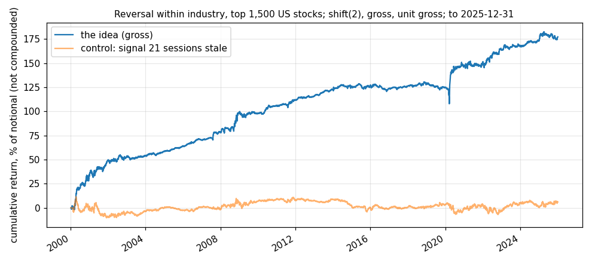

# Idea card — short-term reversal within industry, 1,500 US stocks

**Slug:** `st_reversal_wide` · **Written:** 2026-11-10 · **Status:** EXPLORE, cleared; ready for shadow once a
live equity panel exists · **Reproducer:** `python3 scripts/research/stage_crsp_equities.py --top 2000`, then
`python3 results/ideas/st_reversal_wide/explore.py` · **Panel:** CRSP daily from the R2 mirror, the 2,000
largest US common stocks each month with delisted names included, last date **2025-12-31**.

## The idea

A stock pushed around by someone who had to trade in a hurry comes back once the pressure
ends. The return to buying the week's losers and selling its winners is the wage for
providing that liquidity, and it should be highest when liquidity is scarce.

- **Counterparty:** whoever needed to trade that week whatever the price: a fund meeting
  redemptions, an index change, a stopped-out position.
- **Persistence:** it pays for holding inventory through volatile weeks, which most
  investors will not do, and it turns over too fast for a slow fund.
- **History:** the first-order evidence here is the regime split below. The desk's own BDC
  screen found the same thing in liquid BDCs [S: `results/IDEA_LEDGER.md`].

## The rule (fixed before the test)

Each day, among the 1,500 largest stocks at the previous month end priced at $5 or more:
minus the stock's 5-session return, less its industry's mean (2-digit SIC). Weights are that
signal scaled to unit gross, so the book is dollar neutral within every industry. Decided at
*t*, filled at the next close, earning the session after (`shift(2)`): the one-session gap
keeps bid-ask bounce out.

## Gross result [V: reproducer run three times, identical, 2026-11-10]

No cost is modelled. About 1430 names a day.

| sample | from | to | sessions | active | return / yr | vol / yr | Sharpe | t | bp per active day | hit rate |
|---|---|---|---|---|---|---|---|---|---|---|
| full | 2000-01-12 | 2025-12-31 | 6,532 | 6,532 | 6.84% | 7.10% | 0.96 | 4.90 | 2.7 | 51.5% |
| early half | 2000-01-12 | 2013-01-08 | 3,267 | 3,267 | 8.96% | 7.13% | 1.26 | 4.53 | 3.6 | 53.1% |
| late half | 2013-01-08 | 2025-12-31 | 3,266 | 3,266 | 4.72% | 7.07% | 0.67 | 2.40 | 1.9 | 49.9% |
| 2002-2008 | 2002-01-02 | 2008-12-31 | 1,763 | 1,763 | 7.10% | 5.66% | 1.25 | 3.32 | 2.8 | 53.1% |
| 2009-2015 | 2009-01-02 | 2015-12-31 | 1,762 | 1,762 | 3.99% | 4.68% | 0.85 | 2.26 | 1.6 | 52.7% |
| 2016-2019 | 2016-01-04 | 2019-12-31 | 1,006 | 1,006 | -0.51% | 3.95% | -0.13 | -0.26 | -0.2 | 48.1% |
| 2020-2022 | 2020-01-02 | 2022-12-30 | 756 | 756 | 13.01% | 11.53% | 1.13 | 1.95 | 5.2 | 48.9% |
| 2023-2025 | 2023-01-03 | 2025-12-31 | 752 | 752 | 4.41% | 6.75% | 0.65 | 1.13 | 1.8 | 51.1% |
| control: signal 21 sessions stale | 2000-01-12 | 2025-12-31 | 6,532 | 6,512 | 0.24% | 5.47% | 0.04 | 0.22 | 0.1 | 49.6% |
| control: no industry step | 2000-01-12 | 2025-12-31 | 6,532 | 6,532 | 7.46% | 9.47% | 0.79 | 4.01 | 3.0 | 50.8% |

| regime (market's trailing 21-session volatility, known two sessions ahead) | sessions | return / yr | Sharpe |
|---|---|---|---|
| above its median | 3,255 | 12.36% | 1.35 |
| below its median | 3,277 | 1.35% | 0.32 |

## Reading

- **The effect is there**: Sharpe 0.96 (t 4.90) over 26 years on a universe with no survivorship.
- **The control is clean**: the same signal 21 sessions stale earns 0.04. The industry step
  matters: without it the Sharpe is 0.79, with more volatility.
- **It has weakened**: 1.26 in the first half against 0.67 in the second, and 2016–19 lost a little.
- **It is a high-volatility trade**, as the mechanism says it should be: Sharpe 1.35 when
  market volatility is above its median and 0.32 when below. That is the clearest use so far
  for the market-state layer: size this sleeve up when liquidity is scarce.
- **Exposure:** beta to the equal-weighted market 0.08. Close to market neutral.
- **Capacity is not a constraint.** At $10M the median position is 0.005% of that stock's
  21-session average dollar volume and the 95th percentile is 0.06% (2024–25).
- **Turnover is the open question.** The book turns over 160 times a year, for a gross
  2.7bp a day. Whether that survives real trading is exactly what
  a paper account has to measure; the gross result alone cannot say.

## Next

1. **A live equity panel** for the shadow runner: nightly closes, market values and
   industry codes for about 2,000 stocks. Alpaca's data API has the bars; the market values
   need a source. Until it exists this idea cannot go on shadow.
2. **The conditional form**: the same book scaled by market volatility, which the regime
   table argues for. A sizing rule, tested on the state layer when it is built.
3. **A slower form** (a monthly window) to trade a fraction as often.

