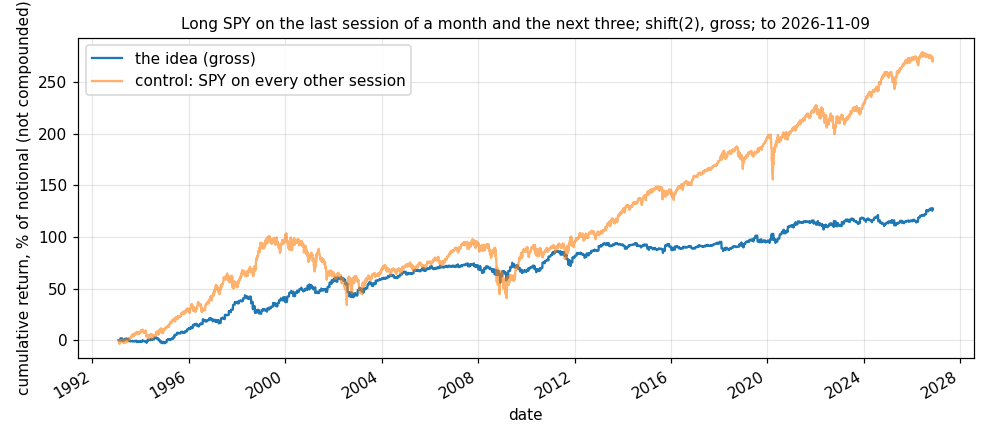

# Idea card — the equity turn of the month

**Slug:** `turn_of_month_eq` · **Written:** 2026-11-10 · **Status:** SET ASIDE as a standalone sleeve ·
**Reproducer:** `python3 results/ideas/turn_of_month_eq/explore.py` · **Panel:** SPY total returns from Yahoo
(`scripts/research/fetch_yf_daily.py`), last date **2026-11-09**.

## The idea

Salaries, pension contributions and fund subscriptions arrive around the month end and are
invested within days, so the equity index should earn more over the last session of a month
and the first three of the next. Nobody on the other side loses knowingly: the flow is not
price-sensitive. The window was fixed before the test.

## Gross result [V: reproducer run 2026-11-10]

`shift(2)` on the canonical harness, unit weight in SPY on window sessions, no cost modelled.

| sample | from | to | sessions | active | return / yr | vol / yr | Sharpe | t | bp per active day | hit rate |
|---|---|---|---|---|---|---|---|---|---|---|
| full | 1993-02-05 | 2026-11-09 | 8,498 | 1,605 | 3.78% | 7.88% | 0.48 | 2.78 | 7.9 | 55.2% |
| early half | 1993-02-05 | 2009-12-17 | 4,250 | 795 | 3.97% | 8.45% | 0.47 | 1.93 | 8.4 | 56.1% |
| late half | 2009-12-17 | 2026-11-09 | 4,249 | 810 | 3.58% | 7.27% | 0.49 | 2.02 | 7.4 | 54.3% |
| 2002-2008 | 2002-01-02 | 2008-12-31 | 1,763 | 334 | 0.95% | 8.61% | 0.11 | 0.29 | 2.0 | 53.9% |
| 2009-2015 | 2009-01-02 | 2015-12-31 | 1,762 | 334 | 3.79% | 7.74% | 0.49 | 1.29 | 7.9 | 52.4% |
| 2016-2019 | 2016-01-04 | 2019-12-31 | 1,006 | 192 | 1.45% | 6.16% | 0.23 | 0.47 | 3.0 | 56.2% |
| 2020-2022 | 2020-01-02 | 2022-12-30 | 756 | 144 | 5.28% | 9.66% | 0.55 | 0.95 | 11.0 | 54.9% |
| 2023-2026 | 2023-01-03 | 2026-11-09 | 967 | 187 | 4.16% | 6.55% | 0.64 | 1.25 | 8.5 | 55.1% |
| control: SPY on every other session | 1993-02-05 | 2026-11-09 | 8,498 | 6,831 | 8.08% | 16.78% | 0.48 | 2.80 | 4.0 | 54.2% |

## Reading

- **The window earns about twice as much a day as other days** (7.9bp against 4.0bp), on
  19% of sessions.
- **It is not a different bet from owning the index.** Its Sharpe (0.48) is the same as the
  control's (0.48): holding SPY on the other 81% of sessions scores as well. The second most
  common way an idea has failed on this desk is a control doing as well as the treatment.
- **The split holds** (0.47 and 0.49), and the eras are uneven: 2002–08 and 2016–19 are
  close to nothing.
- **Capacity is not a constraint**: $10M is 0.026% of SPY's median daily dollar volume in 2026.

## Why it is set aside, and what would reopen it

As a sleeve it is equity beta held a fifth of the time. It would add market exposure to the
book and no independent return. It is worth keeping as a **timing rule for exposure the book
already wants**: if a later sleeve holds equity beta, holding more of it in this window is
free. Reopen with a test anchored on actual pay dates, or on a market-neutral form (small
caps against large, where the flow is said to concentrate [U]).

