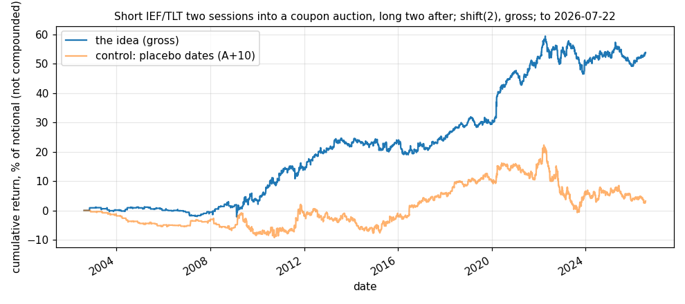

# Idea card — the Treasury auction concession

**Slug:** `ust_auction_cycle` · **Written:** 2026-11-10 · **Status:** EXPLORE, not promoted ·
**Reproducer:** `python3 results/ideas/ust_auction_cycle/explore.py` · **Panels:** IEF and TLT total returns
from Yahoo (`scripts/research/fetch_yf_daily.py`); Treasury auction dates from FiscalData
(`data/auction/auction_calendar.parquet`), last date **2026-07-22**, which ends the test.

## The idea

Primary dealers must bid at each coupon auction, so they cheapen the sector beforehand and
it recovers once the supply is placed. The counterparty is the dealer community hedging
supply it is obliged to take. Short the matching ETF over the two sessions before the
auction and hold it long over the two after; skip the auction day. 7- and 10-year auctions
map to IEF (482 auctions), 20- and 30-year to TLT (291). The rule was fixed before the test.

## Gross result [V: reproducer run 2026-11-10]

`shift(2)` on the canonical harness, half a unit in each ETF, no cost modelled.

| sample | from | to | sessions | active | return / yr | vol / yr | Sharpe | t | bp per active day | hit rate |
|---|---|---|---|---|---|---|---|---|---|---|
| full | 2002-08-14 | 2026-07-22 | 6,022 | 2,503 | 2.25% | 3.97% | 0.57 | 2.77 | 2.2 | 52.5% |
| early half | 2002-08-14 | 2014-07-31 | 3,012 | 868 | 1.88% | 3.18% | 0.59 | 2.04 | 2.6 | 52.3% |
| late half | 2014-07-31 | 2026-07-22 | 3,011 | 1,636 | 2.63% | 4.63% | 0.57 | 1.96 | 1.9 | 52.6% |
| 2002-2008 | 2002-08-14 | 2008-12-31 | 1,608 | 205 | 0.21% | 1.42% | 0.15 | 0.37 | 0.6 | 53.2% |
| 2009-2015 | 2009-01-02 | 2015-12-31 | 1,762 | 832 | 3.19% | 4.34% | 0.74 | 1.95 | 2.7 | 51.8% |
| 2016-2019 | 2016-01-04 | 2019-12-31 | 1,006 | 493 | 1.45% | 3.47% | 0.42 | 0.84 | 1.2 | 51.9% |
| 2020-2022 | 2020-01-02 | 2022-12-30 | 756 | 444 | 8.26% | 5.89% | 1.40 | 2.43 | 5.6 | 57.7% |
| 2023-2026 | 2023-01-03 | 2026-07-22 | 890 | 529 | -0.11% | 4.75% | -0.02 | -0.04 | -0.1 | 49.7% |
| control: placebo dates (A+10) | 2002-08-14 | 2026-07-22 | 6,022 | 2,498 | 0.13% | 3.85% | 0.03 | 0.17 | 0.1 | 48.6% |
| control: IEF only | 2002-08-14 | 2026-07-22 | 6,022 | 1,885 | 2.30% | 3.78% | 0.61 | 2.97 | 2.9 | 52.7% |
| control: TLT only | 2002-08-14 | 2026-07-22 | 6,022 | 1,042 | 2.21% | 6.11% | 0.36 | 1.77 | 5.1 | 53.0% |
| control: outside the month-end window | 2002-08-14 | 2026-07-22 | 6,022 | 2,117 | 1.50% | 3.89% | 0.39 | 1.89 | 1.7 | 51.1% |

Mean return in basis points on each session around the auction (t in brackets):

| | A−5 | A−4 | A−3 | A−2 | A−1 | A | A+1 | A+2 | A+3 | A+4 | A+5 |
|---|---|---|---|---|---|---|---|---|---|---|---|
| IEF | -2.3 (-1.3) | +4.0 (+1.9) | -0.4 (-0.2) | +1.6 (+0.8) | -3.3 (-1.8) | +2.0 (+1.1) | +5.6 (+2.9) | +3.5 (+1.7) | +4.5 (+2.3) | -2.6 (-1.3) | +2.1 (+0.9) |
| TLT | +3.1 (+0.5) | -3.4 (-0.5) | -8.8 (-1.6) | -10.7 (-2.0) | -5.4 (-1.0) | +1.4 (+0.2) | +3.1 (+0.6) | -1.0 (-0.2) | -4.6 (-0.9) | +1.7 (+0.3) | +4.3 (+0.8) |

## Reading

- **There is an effect, and it is modest.** Sharpe 0.57 (t 2.77), the two halves agree (0.59
  and 0.57), and the placebo ten sessions later earns nothing (0.03).
- **A third of it is the month-end trade we already hold.** Seven-year auctions fall in the
  last week of a month, so "long after the auction" overlaps the last three sessions of the
  month. With those sessions removed the Sharpe is 0.39 (t 1.89).
- **It has not worked since 2023** (Sharpe −0.02 over 890 sessions), after its best era in
  2020–22 (1.40). Either the concession moved earlier as auction sizes grew, or it was
  crowded out; the profile cannot tell which.
- **The shape differs by sector.** For the long bond the cheapening is before the auction
  (A−3 to A−1 all negative, A−2 at t −2.0) with no rebound. For the 7- and 10-year the gain
  is after it (A+1 to A+3), which is where the month-end overlap sits.
- **Lookahead, not yet closed [U]:** the panel has auction dates, not announcement dates.
  The decision that earns A−2 is made at A−4. Coupon auctions follow a published cycle, so
  this is probably knowable, but it is unverified until the announcement dates are fetched.

## Why it is not promoted yet, and the next step

It does not clear the Explore bar as it stands: the most recent era is flat and part of the
rest belongs to another sleeve. The promising half is the **long-bond short into the
auction**, which is independent of month end. Next: fetch announcement dates and offering
sizes from FiscalData, and test the pre-auction short alone, scaled by auction size relative
to recent sizes, which is what the dealer-inventory mechanism predicts.

