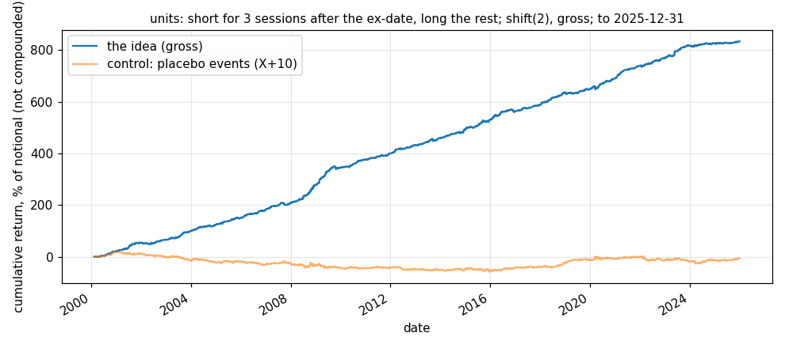

# Idea card — the ex-date fall in other wrappers: partnership and trust units have it

**Slug:** `exdate_other_wrappers` (the part that clears: `units_exdate_drift`) · **Written:** 2026-11-11 ·
**Status:** units SHADOW (two books from 2026-11-11); REITs EXPLORE, weak; ETFs and common stocks SET ASIDE ·
**Reproducer:** `python3 results/ideas/exdate_other_wrappers/explore.py` ·
**Panels:** CRSP daily on R2, last date **2025-12-31** (`scripts/research/stage_crsp_exdate_groups.py`,
`scripts/research/stage_crsp_equities.py --top 2000`). Not in the repository.

## The idea

Closed-end funds keep falling for three sessions after an ex-date
(`results/ideas/2026-11-10_cef_exdate_drift.md`). If the cause is income investors buying
for the distribution and selling after it, other securities held for income should show the
same thing. This is the first test under the team lead's 2026-11-11 instruction to look for
event ideas in every asset class.

## What was fixed before the test

The closed-end fund test, unchanged and imported from its file: short a security from its
ex-date close for three sessions, long the group's other eligible names equally, price of $2
or more and average daily volume of $500,000 or more, `shift(2)`, gross, no cost and no
borrow modelled. The four groups come from CRSP's type codes and were set before any return
was read. Dead securities are included.

## Gross result [V: reproducer run 2026-11-11]

| group | eligible ex-dates | a year | Sharpe | t | return / yr | halves | placebo (X+10) | X−3..X−1, bp | X+1..X+3, bp |
|---|---|---|---|---|---|---|---|---|---|
| units | 9,044 | 349 | 3.03 | 15.40 | 32.26% | 3.34 / 2.77 | -0.02 | +44.2 | -85.2 |
| reit | 13,050 | 503 | 0.91 | 4.62 | 6.77% | 1.00 / 0.81 | 0.10 | +13.8 | -13.2 |
| etf | 101,481 | 3911 | 0.28 | 1.44 | 1.56% | 0.36 / 0.18 | 0.34 | -1.0 | -0.5 |
| common | 89,569 | 3452 | -0.02 | -0.12 | -0.11% | -0.04 / -0.01 | -0.51 | +1.8 | -0.7 |

The last two columns are the event names' total return less the group's eligible average,
summed over three sessions. 2000-02-15 to 2025-12-29.

- **Units** are partnership and trust units (CRSP share type UG): energy partnerships,
  royalty trusts and a few others; 242 of them had an eligible ex-date.
  Eras: 2002-2008 3.16, 2009-2015 3.39, 2016-2019 2.77, 2020-2022 3.08, 2023-2025 2.10.
- **REITs** show the same shape at about a sixth of the size, and the book lost money in 2023–25
  (Sharpe −0.45).
- **ETFs and the 1,500 largest common stocks show nothing.** The ETF placebo scores as well
  as the event. In common stocks the only move is on the ex-date itself (+7.5bp).

## Is the units result an artifact? [V: checks run in the session 2026-11-11, not stored]

- **The ex-date is dated correctly.** On the ex-date the price falls 203.5bp against a mean
  distribution of 176.8bp, and the fall moves 1.18 for 1 with the distribution's size. If
  CRSP dated the event a day early, the fall would show up on X+1 with that slope; the X+1
  slope is 0.14.
- **Not stale prices.** One eligible ex-date of 9,044 had no volume.
- **It is in liquid units too**: X+1..X+3 is −106.7bp at $0.5–2M of daily volume, −81.7bp at
  $2–10M and −61.4bp above $10M (t −8.4).
- **Both halves of the events**: −81.9bp for 2000–12, −86.5bp for 2013–25.
- **It grows with the distribution**: by quartile of distribution size the three-session
  fall is −52.9, −44.8, −59.9 and −180.0bp.

## What the gross figure does not show

- **Borrow.** The trade is a short in partnership units and royalty trusts. Some are hard
  to borrow, and paper charges nothing for it [U until the broker's list is read].
- **Few names.** About 4 units are in a window on an average day, and 51 units had an
  ex-date after 2025-06, so the book is concentrated and small. Capacity is unmeasured here.
- **Known the day before.** The test assumes the ex-date is known a session ahead. A shadow
  book must read declared ex-dates from a live source, as the fund books do.
- **The mirror ends 2025-12-31**; nothing here is from 2026.

## On shadow from 2026-11-11

Two books, $1M each, on 48 live units (`shadow/universes/units_v1.csv`, rebuilt from the
public exchange directory because CRSP's list cannot be published; it holds 46 of the 51
CRSP units with a recent ex-date): `units_exdate_after`, the pre-specified short-after
book, and `units_exdate_before_after`, long before and short after, which is not
pre-specified. They reuse the fund books' signal code unchanged.
- **14 of the 48 were not shortable at Alpaca on 2026-11-11.** A shadow book ignores borrow,
  so its short leg overstates what a paper account could hold.
- **Unit distributions cluster by quarter**, so both books will be flat on many days. The
  long-before book is also flat whenever nothing is in a post-ex window, by its own rule.
- Their first decisions, for 2026-11-11, were flat: no unit had an ex-date on 11-10 to 11-12
  [V: local run 2026-11-11 20:13 New York, which is too late to be scored].

## Added 2026-11-12: unit ex-dates were known in advance [V: CRSP `stkdistributions` on R2, queried 2026-11-12, not stored]

Of 12,987 ordinary distributions by units since 2000, 98.9% were declared at least one day before the ex-date and 98.2% at least three; the median gap is 9 days; 0.9% have no declaration date. So the "known the day before" assumption above holds for the short-after book.

