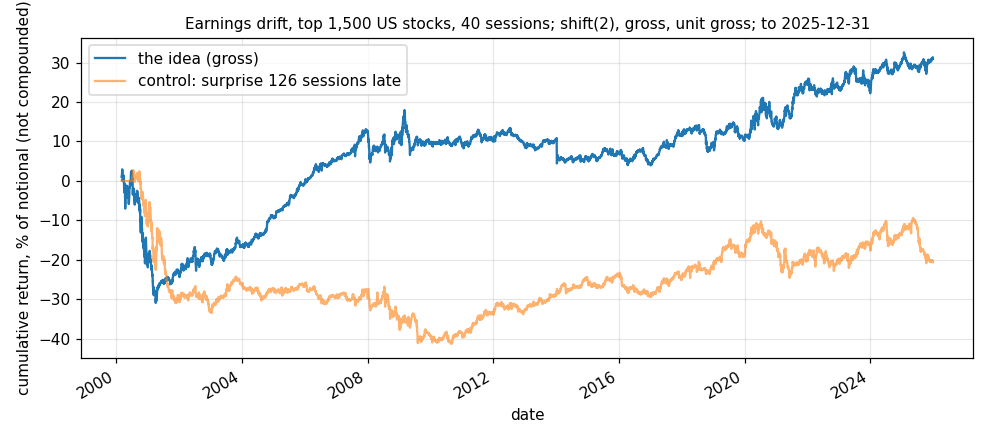

# Idea card — earnings drift on the 1,500 largest US stocks

**Slug:** `pead_wide` · **Written:** 2026-11-11 · **Status:** EXPLORE, not promoted ·
**Reproducer:** `python3 results/ideas/pead_wide/explore.py` (the fixed test) and
`python3 results/ideas/pead_wide/event_time.py` (the diagnostic and the variant) ·
**Panels:** CRSP daily on R2, last date **2025-12-31** (`scripts/research/stage_crsp_equities.py --top 2000`);
IBES quarterly EPS surprises on R2, last announcement used **2025-12-29**
(`scripts/research/stage_ibes_surprises.py`). Neither panel is in the repository.

## The idea

Investors under-react to an earnings surprise, so the price keeps moving the same way for
weeks. The other side is holders who anchor on the old estimate. The card in
`results/ideas/2026-11-10_hunt_all.md` (#3) expected the effect to be weaker in large stocks.

## What was fixed before the test

Each US quarterly EPS release in IBES is known at the close of its own session if its time is
before 16:00 New York, and at the next session's close otherwise (also when the time is the
00:00 placeholder, 0.3% of rows). For 40 sessions from then the stock carries its surprise
score: actual less the consensus before the release, over the spread of the estimates. Each
day the book is long the top tenth and short the bottom tenth of the stocks carrying a score,
among the top 1,500 by the previous month-end's market value and priced at $5 or more; equal
weights, unit gross. `shift(2)`: the announcement day's own move is never earned.

## Gross result of the fixed test [V: reproducer run 2026-11-11]

| sample | from | to | sessions | active | return / yr | vol / yr | Sharpe | t | bp per active day | hit rate |
|---|---|---|---|---|---|---|---|---|---|---|
| full | 2000-03-03 | 2025-12-31 | 6,497 | 6,497 | 1.20% | 5.59% | 0.21 | 1.09 | 0.5 | 52.1% |
| early half | 2000-03-03 | 2013-02-01 | 3,249 | 3,249 | 0.71% | 6.14% | 0.12 | 0.42 | 0.3 | 51.2% |
| late half | 2013-02-01 | 2025-12-31 | 3,249 | 3,249 | 1.68% | 4.98% | 0.34 | 1.21 | 0.7 | 53.0% |
| 2002-2008 | 2002-01-02 | 2008-12-31 | 1,763 | 1,763 | 4.97% | 4.44% | 1.12 | 2.96 | 2.0 | 53.5% |
| 2009-2015 | 2009-01-02 | 2015-12-31 | 1,762 | 1,762 | -0.65% | 4.58% | -0.14 | -0.38 | -0.3 | 50.2% |
| 2016-2019 | 2016-01-04 | 2019-12-31 | 1,006 | 1,006 | 0.74% | 3.79% | 0.20 | 0.39 | 0.3 | 53.1% |
| 2020-2022 | 2020-01-02 | 2022-12-30 | 756 | 756 | 4.49% | 6.73% | 0.67 | 1.16 | 1.8 | 52.9% |
| 2023-2025 | 2023-01-03 | 2025-12-31 | 752 | 752 | 2.44% | 4.93% | 0.50 | 0.86 | 1.0 | 53.7% |
| control: surprise 126 sessions late | 2000-03-03 | 2025-12-31 | 6,497 | 6,411 | -0.80% | 4.97% | -0.16 | -0.82 | -0.3 | 50.4% |
| control: ranks 1-500 only | 2000-03-03 | 2025-12-31 | 6,497 | 6,497 | 2.20% | 6.67% | 0.33 | 1.68 | 0.9 | 52.5% |
| control: ranks 501-1500 only | 2000-03-03 | 2025-12-31 | 6,497 | 6,497 | 0.81% | 6.34% | 0.13 | 0.65 | 0.3 | 52.0% |

255,475 releases; about 175 positions a day; turnover
39 times a year; beta to the equal-weighted market 0.01.

## Reading

- **The fixed test does not clear.** Sharpe 0.21 (t 1.09) over 2000 to 2025; 0.12 and 0.34
  by half. The spread is positive in four of five eras but about half a basis point a day.
- **The control behaves.** The same surprise 126 sessions late earns −0.16: what is there is
  tied to the recent release.
- **It is not stronger in smaller stocks here.** Ranks 1 to 500 score 0.33 and ranks 501 to
  1,500 score 0.13, the opposite of what the card expected. Both are within noise.
- **Most of the spread is on the short side**: the short leg earns 1.78% a year against the
  equal-weighted market, the long leg 0.61%.
- **Capacity is not a constraint**: at $10M the 95th-percentile position is 0.39% of the
  stock's average daily dollar volume (2024–25).

## Where the drift sits [V: `event_time.py`, run 2026-11-11]

Top tenth less bottom tenth, market-adjusted, in basis points, summed from session t+2 (the
first a `shift(2)` book can earn) to t+k. Tenths are formed within each calendar quarter, so
this table describes and is not a tradable rule. 141,703 releases, 2000-01-04 to 2025-10-01.

| sort | sample | k=3 | k=6 | k=11 | k=21 | k=41 | k=61 |
|---|---|---|---|---|---|---|---|
| surprise score | all | 20.1 | 26.1 | 29.1 | 41.1 | 56.8 | 67.2 |
| surprise score | 2000–2012 | 31.7 | 37.3 | 40.9 | 48.3 | 43.0 | 29.5 |
| surprise score | 2013–2025 | 8.8 | 15.5 | 17.7 | 34.2 | 70.0 | 103.5 |
| announcement move | all | 14.8 | 26.2 | 45.8 | 71.2 | 105.7 | 112.9 |
| announcement move | 2000–2012 | 13.3 | 30.3 | 56.3 | 102.3 | 145.4 | 165.6 |
| announcement move | 2013–2025 | 16.2 | 22.3 | 35.8 | 41.3 | 67.5 | 62.3 |

The announcement move is the stock's return less the equal-weighted market over the two
sessions ending at t. It sorts the later drift about twice as well as the analyst score.

## The variant, chosen after seeing that table (NOT pre-specified)

The same book sorted on the announcement move. Two holding periods were run, and both are shown.

| hold | full | to 2012 | 2013 on | 2023 on |
|---|---|---|---|---|
| 20 sessions | Sharpe 0.52, 4.10% / yr | 0.67 | 0.32 | −0.53 |
| 40 sessions | Sharpe 0.73, 3.80% / yr | 0.88 | 0.55 | 0.97 |

The 40-session form is the better of two tries on a sort picked with sight of the data, so
0.73 overstates it. It also fades: 0.88 before 2013, 0.55 after.

## Verdict, and what would move it

Drift after earnings is present in large US stocks and small: about one basis point a day
on the spread. It is not promoted. Two things would change that:
- a pre-specified test of the announcement-move sort on data this card has not seen (CRSP
  2026 when the mirror updates, or a shadow book);
- a live source of announcement dates and times. The IBES mirror ends 2026-05-14, so a
  shadow book needs a free calendar first, and the same live equity panel that
  `st_reversal_wide` is waiting for.

It may still earn a place in the combined model as a slow signal with low turnover
(39 times a year against the reversal's 160) and no market beta.

