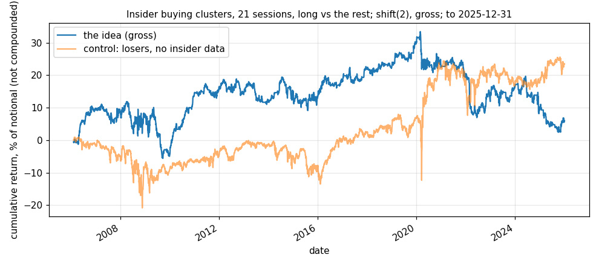

# Idea card — clustered insider buying in the 2,000 largest US stocks: no effect

**Slug:** `insider_clusters` · **Written:** 2026-11-12 · **Status:** SET ASIDE in liquid stocks ·
**Reproducer:** `python3 results/ideas/insider_clusters/explore.py` ·
**Panels:** the SEC's Insider Transactions Data Sets, Form 4 purchases 2006Q1 to 2025Q4, as clustered by
`scripts/events/ssx/ssx_ins_insider_census.py` (last cluster **2025-12-30**); CRSP daily on R2, last date
**2025-12-31**. The cluster file is public EDGAR data kept outside the repository for size; CRSP is licensed.

## The idea

Three or more directors or officers buying their own stock on the open market within 30 days
know something, and the price is slow to take it in (card D1 in
`results/events/ssx/ssx_ins/CARDS_2026-10-19.md`, which fixed the event rule on 2026-10-19
before any return was read). The other side is whoever sells after the Form 4 is public.

## What was fixed before the test

The October event rule, unchanged. A cluster is known at the first session after the filing
that completes it. Each matched stock is held long for 21 sessions against an equal-weighted
short in every other eligible stock (in the 2,000 largest by the previous month-end's market
value, $5 or more). A day with fewer than 5 cluster stocks is flat. `shift(2)`, gross.

## Gross result [V: reproducer run 2026-11-12]

| sample | from | to | sessions | active | return / yr | vol / yr | Sharpe | t | bp per active day | hit rate |
|---|---|---|---|---|---|---|---|---|---|---|
| full | 2006-02-08 | 2025-12-31 | 5,006 | 4,108 | 0.30% | 6.48% | 0.05 | 0.21 | 0.1 | 48.9% |
| early half | 2006-02-08 | 2016-01-20 | 2,504 | 2,154 | 1.54% | 6.69% | 0.23 | 0.72 | 0.7 | 49.0% |
| late half | 2016-01-20 | 2025-12-31 | 2,503 | 1,955 | -0.90% | 6.26% | -0.14 | -0.45 | -0.5 | 48.8% |
| 2002-2008 | 2006-02-08 | 2008-12-31 | 730 | 700 | 2.49% | 8.44% | 0.30 | 0.50 | 1.0 | 47.3% |
| 2009-2015 | 2009-01-02 | 2015-12-31 | 1,762 | 1,442 | 0.89% | 5.81% | 0.15 | 0.40 | 0.4 | 49.7% |
| 2016-2019 | 2016-01-04 | 2019-12-31 | 1,006 | 815 | 4.24% | 4.46% | 0.95 | 1.90 | 2.1 | 51.3% |
| 2020-2022 | 2020-01-02 | 2022-12-30 | 756 | 596 | -5.50% | 8.01% | -0.69 | -1.19 | -2.8 | 47.0% |
| 2023-2025 | 2023-01-03 | 2025-12-31 | 752 | 555 | -2.61% | 6.33% | -0.41 | -0.71 | -1.4 | 47.4% |
| control: events 126 sessions late | 2006-02-08 | 2025-12-31 | 5,006 | 3,936 | -2.03% | 6.13% | -0.33 | -1.48 | -1.0 | 48.0% |
| control: losers, no insider data | 2006-02-08 | 2025-12-31 | 5,006 | 5,006 | 1.18% | 7.47% | 0.16 | 0.71 | 0.5 | 49.0% |
| control: held 60 sessions (shown, not chosen) | 2006-02-08 | 2025-12-31 | 5,006 | 5,006 | -0.62% | 5.41% | -0.11 | -0.51 | -0.2 | 47.2% |
| control: book less its loading on the losers control | 2006-02-08 | 2025-12-31 | 5,006 | 5,006 | 0.05% | 6.27% | 0.01 | 0.03 | 0.0 | 49.4% |

14,421 clean clusters; 3,725 (26%) are in the panel on their date; about
14 cluster stocks held a day; 18% of sessions flat; beta 0.09.

## Reading

- **No effect.** Sharpe 0.05 (t 0.21) over 2006 to 2025; 0.23 and −0.14 by half; negative
  in both eras since 2020. Holding 60 sessions instead (run alongside, not chosen) is −0.11.
- **What little there is, is buying losers.** The book's correlation with a control that
  buys the worst tenth by one-month return, with no insider data, is 0.25; with that
  loading removed the book earns 0.05% a year.
- **Only a quarter of the clusters are in these stocks.** Insider buying clusters sit mostly
  in companies smaller than the 2,000th. This test says nothing about them, and at $1M a
  position there would be a large share of a day's volume: even inside the panel the
  95th-percentile position is 1.2% of average daily volume at $1M and 12% at $10M (2024–25).

## Verdict, and what would reopen it

Set aside for stocks liquid enough for this desk's size. It would reopen on a small-capital
test in stocks below the 2,000th (a different, capacity-limited book), or on a narrower
event with a mechanism for why it differs: first-ever purchases, purchases by the chief
executive or finance chief, or purchases into a tender or a spin-off.

