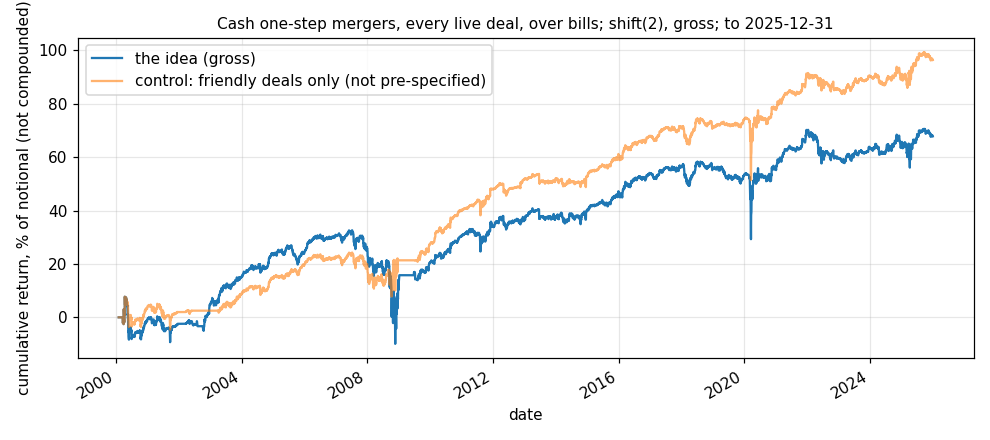
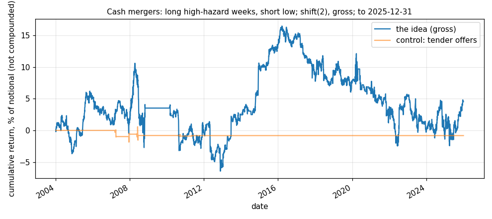

# Idea card — merger arbitrage in US cash deals: a modest premium in agreed deals, no event-time spread

**Slugs:** `ma_premium`, `ma_hazard` · **Written:** 2026-11-12 ·
**Status:** `ma_premium` EXPLORE, a risk premium, not yet on shadow (no live deal feed); `ma_hazard` SET ASIDE ·
**Reproducer:** `python3 results/ideas/merger_arb/explore.py`; cross-check `python3 results/ideas/merger_arb/crosscheck_edgar.py` ·
**Panels:** SDC mergers and CRSP daily on R2 (`scripts/research/stage_sdc_deals.py`), deals announced 2000-01-01 to
2025-12-31, prices to **2025-12-31**; SPY total returns from Yahoo (2026-11-09); 3-month bill yield from FRED
(`~/quantt_data/riskfree_daily.parquet`, to 2026-07-16). SDC and CRSP rows are not in the repository.

## The two ideas

1. **The premium.** After a cash deal is announced the target trades below the offer. A
   holder earns the gap if the deal closes and takes a large loss if it breaks. The other
   side is the target's old holders, who sell rather than carry that risk.
2. **The event-time spread** (Giglio & Shue 2014; this desk's design note
   `results/events/MERGER_ARB_V2_2026-10-19.md`). Deals mostly close in a known range of
   weeks. If holders under-react to time passing, deals should earn more in the weeks when
   closing is likely than in the weeks when it is not.

Neither had a return computed on this desk before: the October work stopped at counts,
under gates the team lead dropped on 2026-11-09.

## Two things found in the data before any result [V: run 2026-11-12]

- **The desk's EDGAR deal list cannot be used from the announcement date.** It finds a
  one-step merger by its proxy statement, filed weeks later, so a deal that breaks before
  its proxy is missing. Returns measured from the announcement would be conditioned on
  survival. SDC records deals when announced and keeps withdrawn ones, so SDC is used here.
- **SDC's announcement date can be a session early.** The target's mean return is
  +23.7% on SDC's date and +6.9% on the next session, then +0.03%. The
  test's first earned return is three sessions after SDC's date, so none of the jump is in
  any figure below. Entering one session sooner would have put part of it in.
- **CRSP's new-format return carries the cash paid at closing** on an extra row dated the
  next session: it equals the legacy file's separate delisting return on 98.3% of 2,137
  merger delistings, and where it differs the legacy value is missing.

## What was fixed before the test

All-cash bids for US public targets, SDC form 'Merger', linked to one CRSP common share
(6,104 of 9,202 deals link; the rest are not exchange-listed). A deal is entered at the
close of the first session after the announcement if the target closes at $5 or more with
$1M of average daily volume. It is held until the target stops trading, the session after
SDC's withdrawal date, or 252 sessions. A broken deal is held through the break. Equal
weights, flat under 5 deals, `shift(2)`, gross, no cost and no borrow modelled. SDC's final
status is never read by a rule. The event-time book re-estimates each month, from deals
announced at least a year earlier, which four-week blocks have an above-average chance of
closing; it is long deals in those blocks and short the rest.

## The universe had to be corrected after the first run (so the corrected book is NOT pre-specified)

SDC's 'Merger' form includes unsolicited and hostile proposals: 155 of the 1,529 eligible
one-step deals, and 148 of them (95%) were later withdrawn. They are bids, not agreed deals.
Friendly deals were withdrawn 8.3% of the time. The books marked *friendly* keep only deals
SDC marks Friendly. SDC's own attitude-changed flag is set on 0.1% of eligible deals, so the
mark is rarely revised; whether it is ever set after the fact is [U].

## Gross results [V: reproducer run 2026-11-12]

| book | deals held | live a day | raw Sharpe (t) | halves | over bills / yr | vol | Sharpe over bills | max drawdown | beta to SPY | alpha / yr (t) |
|---|---|---|---|---|---|---|---|---|---|---|
| premium, one-step, as pre-specified | 1,529 | 20 | 0.50 (2.53) | 0.49 / 0.52 | 2.62% | 9.03% | 0.29 | -42.5% | 0.23 | 0.83% (0.64) |
| premium, one-step, friendly | 1,366 | 18 | 0.71 (3.63) | 0.71 / 0.73 | 3.73% | 7.79% | 0.48 | -23.4% | 0.17 | 2.38% (2.19) |
| premium, tender offers, friendly | 499 | 2 | 0.64 (3.27) | 0.86 / 0.37 | 2.98% | 5.38% | 0.55 | -11.0% | 0.03 | 2.75% (3.05) |

"Raw" is the convention of every other Explore table. "Over bills" subtracts the 3-month
bill yield on invested days: a cash deal's spread includes the bill rate, so the raw figure
flatters it. Drawdown is on summed daily returns. 2000-02-01 to 2025-12-31.

- **Friendly one-step, by era (raw Sharpe):** 2002-2008 0.56, 2009-2015 1.22, 2016-2019 1.12, 2020-2022 0.40, 2023-2025 1.32.
- **The loss is concentrated**: the pre-specified book's worst stretch is 2007-07 to
  2008-11, when buyout deals broke together and the number of live deals fell to about ten;
  its worst days are in March 2020.
- **Beta is low on average and the monthly crash beta is not visible here**: in the
  41 months when SPY fell more than 4% the friendly book lost 0.51% on average. The 2007–08
  drawdown is the better measure of the tail than that average.
- **Tender offers are too few to be a book**: about 2 live a day; the book is flat on
  76% of sessions and has barely traded since 2013.
- **Larger targets did better than smaller ones** (Sharpe over bills 0.44 against 0.27,
  friendly), the opposite of the limits-to-arbitrage story.
- **Capacity**: at $10M the median position is 1.3% of the target's average daily volume and
  the 95th percentile 18% (2024–25, pre-specified book). At $1M it is 0.13% and 1.8%.
- **Turnover** is about 10 times a year; a deal is held a median of 70 sessions.

## The event-time spread: nothing

| book | raw Sharpe (t) | halves | long leg over bills / yr | short leg over bills / yr | beta |
|---|---|---|---|---|---|
| as pre-specified | 0.04 (0.21) | 0.22 / -0.10 | 0.81% | 0.40% | -0.01 |
| friendly | 0.06 (0.29) | 0.03 / 0.09 | 2.44% | 1.94% | -0.01 |

- **The precondition holds and the trade does not.** Deals do close in a hump: weeks 9 to 28
  were classed High in nearly every one of 281 months. But deals in those weeks earn
  no more than deals outside them.
- **Where the return sits in a friendly deal's life**, mean over bills in bp a day (t by day):

  | weeks | 1–4 | 5–8 | 9–12 | 13–16 | 17–20 | 21–24 | 25–28 | 29–32 | 33–36 | 37–40 | 41–44 | 45–48 | 49–52 |
  |---|---|---|---|---|---|---|---|---|---|---|---|---|---|
  | bp/day (t) | +2.5 (+2.1) | +2.2 (+1.4) | +2.8 (+3.0) | -0.6 (-0.5) | +0.4 (+0.2) | +0.7 (+0.4) | +2.1 (+1.0) | +1.9 (+0.7) | +1.3 (+0.4) | +6.0 (+0.9) | +3.5 (+0.9) | +1.9 (+0.4) | -8.4 (-1.2) |

  The return is earned in the first twelve weeks, eight of which the rule classes as
  low-hazard. Weeks 13 to 24, which it classes as high and where closings peak, earn about
  nothing. That is the reverse of the under-reaction story on this sample. The later blocks
  hold few deals and are noise.
- **The control could not be run**: the same rule on tender offers was invested on 1% of
  sessions. UNMEASURED, not a pass.

## The cross-check on the desk's EDGAR list [V: `crosscheck_edgar.py`, run 2026-11-12]

Only the 2001–09 deals carry a first-proxy date; the 1,595 later ones do not and are left
out. Entered from the session after the first proxy, the one-step book has a raw Sharpe of
0.36 with 19.6% volatility and a beta of 0.69; the SDC friendly book over the same
sessions scores 0.61, and the two correlate 0.48 daily. **This neither confirms nor
contradicts.** The EDGAR list has no break date, so a broken deal stays in the book as an
ordinary small stock for up to a year, which is where the volatility and beta come from.
It does show what a live book must have: a dated signal that a deal has broken.

## Independent review [V: quant-reviewer agent, 2026-11-12]

A separate reviewer re-derived the friendly premium (raw 0.713, 0.478 over bills) and found
no material defect. Its checks: weights rebuilt on data cut at 14 random dates matched the
full-data weights exactly; scoring with one more session of delay gives 0.717, so the result
does not depend on entry timing; the break is earned (−2.7% on the withdrawal session and
−3.2% on the next, both held); the cash paid at closing is earned once per deal; the ten
best name-days sum to +0.39 and the ten worst to −0.28 over 26 years. Four minor points
were fixed and the test re-run before these figures were recorded: one week-numbering
mismatch in the event-time book (it moved that book from 0.01 to 0.04), a count of missing
returns on held names (none), and two missing counts in the staging output.

**A selection that remains.** The staging keeps deals whose final SDC status is Completed,
Withdrawn or Pending. Across all 'Merger' rows for US public targets, 2000–2025, that leaves
out 830 rows: 588 rumours, 212 companies seeking a buyer, 22 statements of intent and 8
others. Rumours and sale processes are not announced deals, but the status is set after the
fact, so a deal first recorded as intended and later firmed up or dropped is classed with
hindsight. Its size on the result is unmeasured.

## Verdict

- **`ma_premium`: EXPLORE.** In agreed cash deals the premium is real and steady across both
  halves (raw Sharpe 0.71, t 3.63; 0.48 over bills), with low beta and a tail that showed in
  2007–08. It is a risk premium, which the 2026-11-09 ruling allows as a sized sleeve. Two
  cautions: the friendly filter was chosen after the first run, and the pre-specified
  universe scores 0.29 over bills.
- **`ma_hazard`: SET ASIDE.** No spread (raw Sharpe 0.04; 0.06 on friendly deals), and the event-time profile points the other way.
- **Not on shadow yet.** A shadow book needs a free, live list of agreed deals with
  announcement and break dates. EDGAR has both (8-K item 1.01 for the agreement, item 1.02
  for its termination) and the October code reads the first; the list has to be rebuilt to
  keep the first-proxy date and to read terminations. That is the next piece of work on this
  idea. SDC on R2 ends 2026-07 and is not a live source.
- **Untested here:** stock deals (they need the exchange ratio for the hedge, which SDC's
  text gives unreliably), costs, and deals below the $5 and $1M floors.

